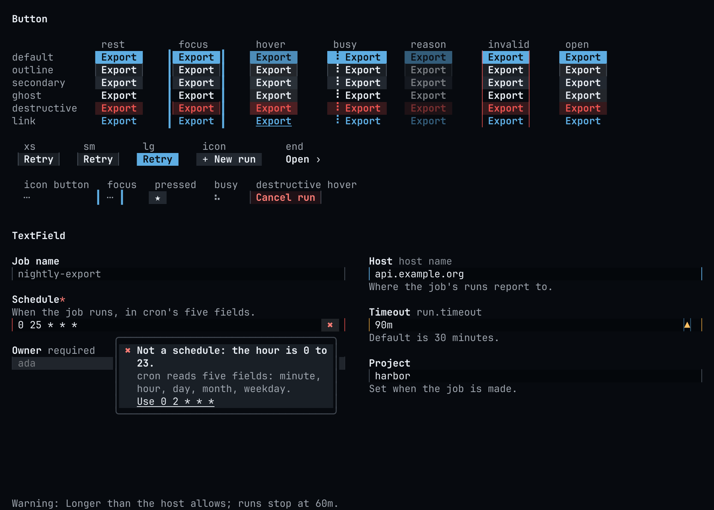
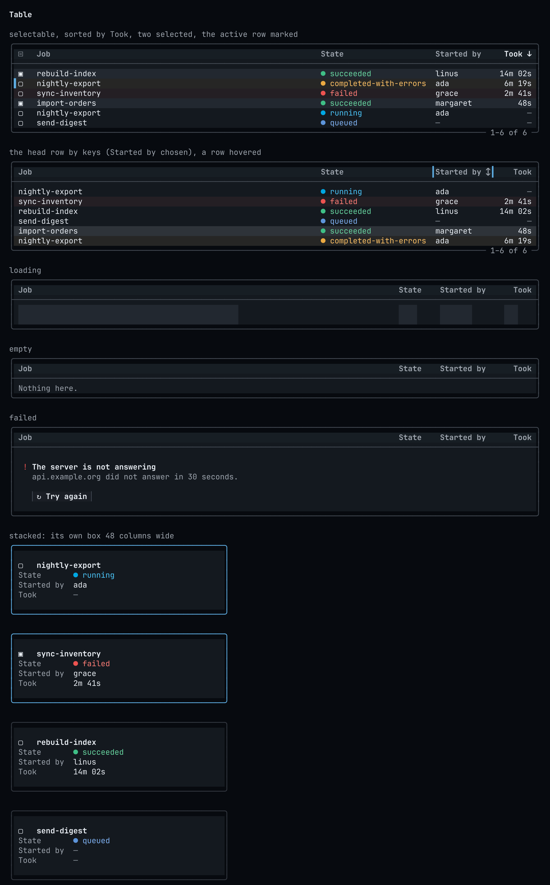
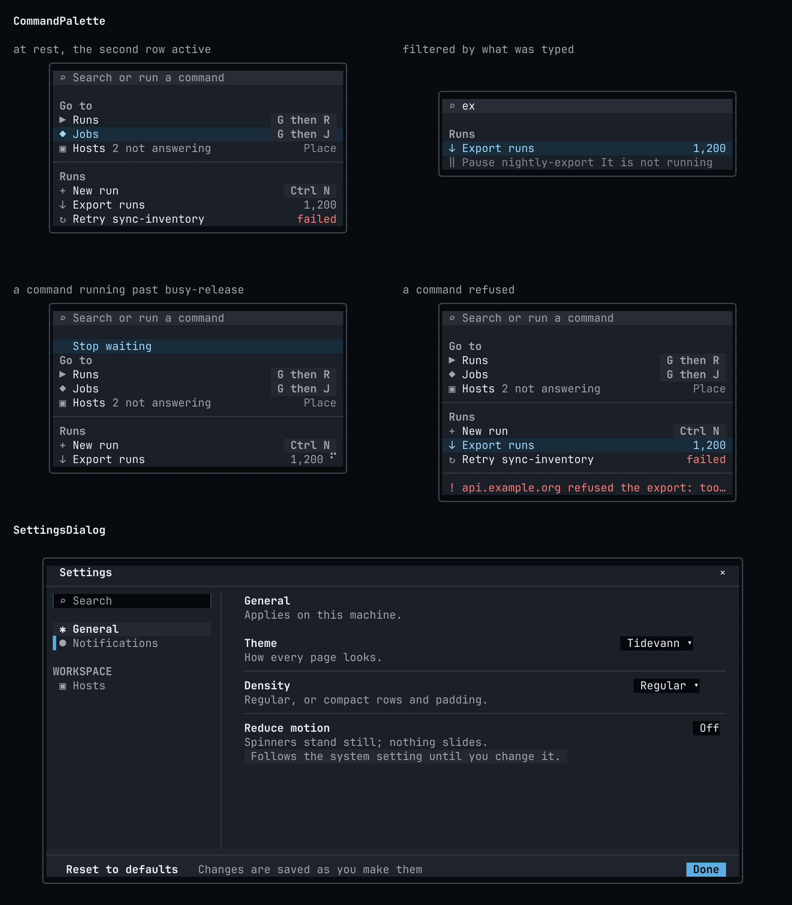

# sokkel-tui

sokkel's design system in a terminal, with ratatui. The same contract as sokkel-ui and
sokkel-egui ([sokkel-design](https://winterop-com.github.io/sokkel-design/): its tokens, paints,
parts and the shell), drawn in cells.


## What is here

- `crates/core` (`sokkel-tui`): sokkel-design's resolved tokens embedded; the look (theme, scheme,
  density, color depth: truecolor, 256 or none); text roles as a cell shows them; px in columns
  and the breakpoints in columns (`md` about 90, `lg` about 120); a buffer as SVG and as text.
- Focus and keys: tab order, layers, the ring on keyboard focus, a shortcuts registry by typed
  character.
- The parts, each from its spec in sokkel-design: `Button`, `TextField`, `PageState`, `PageHeader`,
  `Section`, `Table`, the frame (`Rail`, `TopBar`, `StatusLine`), and the overlays `Dialog`,
  `DropdownMenu`, `Select`, `CommandPalette` and `SettingsDialog`.
- `crates/core/examples/`, a progression to run in a terminal (`-- light` for the light scheme;
  Ctrl+Q quits):
  - `01_basic`: a form, focus by Tab, a button with its reason and its busy moment.
  - `02_page`: a page header and a read in its states (keys 1 to 4), sections.
  - `03_table`: the one table, by keys and mouse; narrow the terminal for cards.
  - `04_overlays`: a menu with a submenu, a select, a confirm dialog that holds.
  - `05_palette`: the command palette (Ctrl+K, every theme) and the settings dialog.
  - `06_shell`: the frame drawn to SVG and text.
  - `07_runs`: Tidevann's runs, every part together.
  - `08_gallery`: every part's sheet, browsed (t theme, s scheme, a ASCII, c no color).









## Use

```
make all          # fmt-check, clippy, tests
make specimens    # the spike and the parts sheet: specimens/*.svg, *.png (with rsvg-convert) and *.txt
make tokens       # fetch sokkel-design's resolved tokens at the pinned commit (REF=<commit> moves it)
```

`docs/plan.md` has the order the parts come in. `docs/proposals/sokkel-design-tui.md` is what the
terminal asks of the contract.
