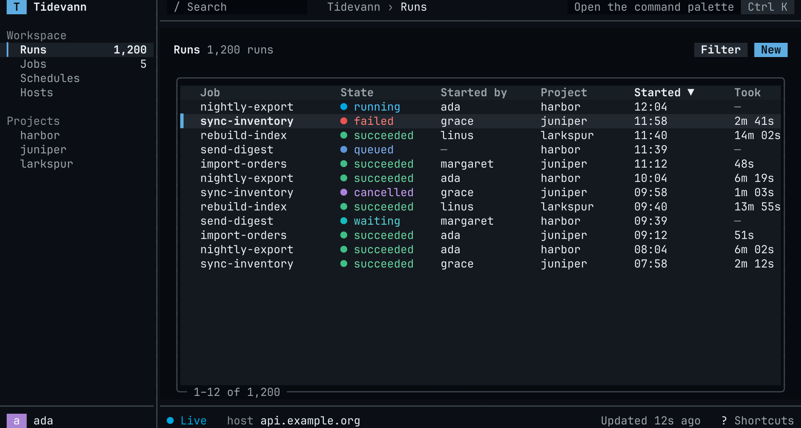

# sokkel-tui

sokkel's design system in a terminal, with ratatui. The same contract as sokkel-ui and
sokkel-egui ([sokkel-design](https://winterop-com.github.io/sokkel-design/): its tokens, paints,
parts and the shell), drawn in cells.



## What is here

- `crates/core` (`sokkel-tui`): sokkel-design's resolved tokens embedded; the look (theme, scheme,
  density, color depth: truecolor, 256 or none); text roles as a cell shows them; px in columns
  and the breakpoints in columns (`md` about 90, `lg` about 120); a buffer as SVG and as text.
- Focus and keys: tab order, layers, the ring on keyboard focus, a shortcuts registry by typed
  character.
- The parts, each from its spec in sokkel-design: `Button`, `TextField`, `PageState`, `PageHeader`
  and `Section` so far.
- `examples/spike`: the shell and the runs table drawn from the paints, static, written to
  `specimens/` as SVG, PNG and text.
- `examples/parts`: the parts sheets, every part in its variants and states.


## Use

```
make all          # fmt-check, clippy, tests
make specimens    # the spike and the parts sheet: specimens/*.svg, *.png (with rsvg-convert) and *.txt
make tokens       # fetch sokkel-design's resolved tokens at the pinned commit (REF=<commit> moves it)
```

`docs/plan.md` has the order the parts come in. `docs/proposals/sokkel-design-tui.md` is what the
terminal asks of the contract.
