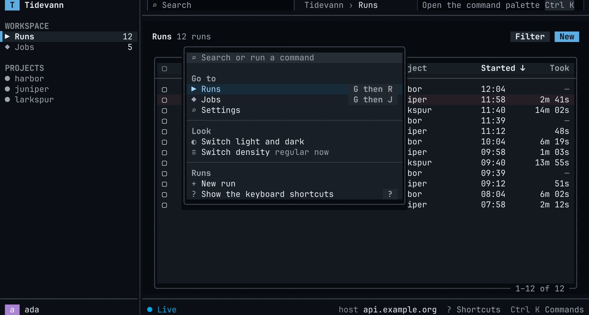
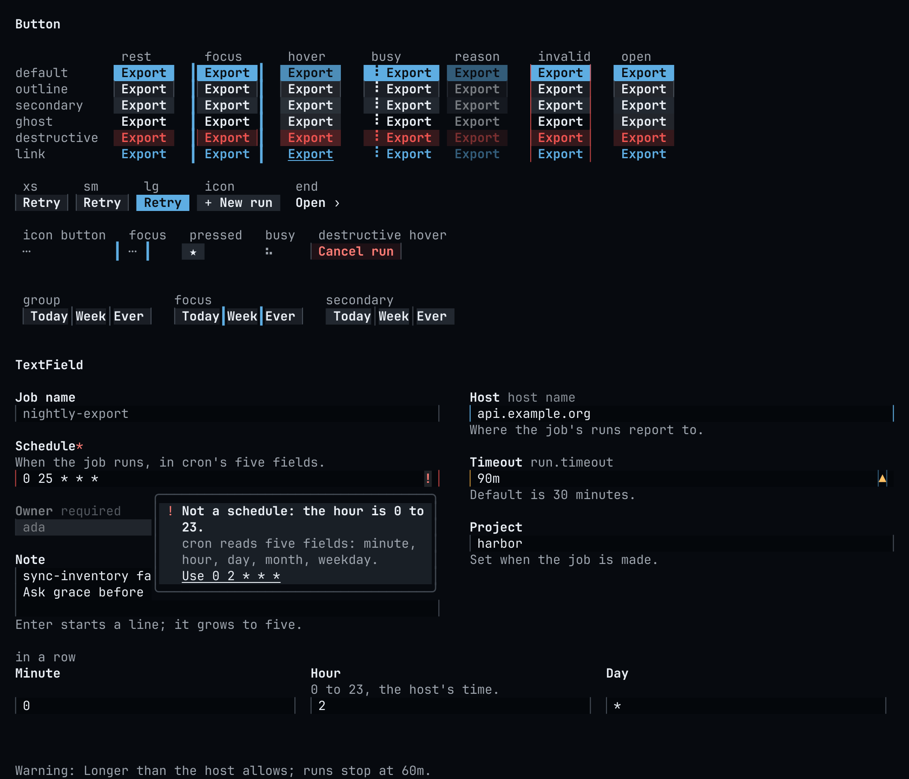
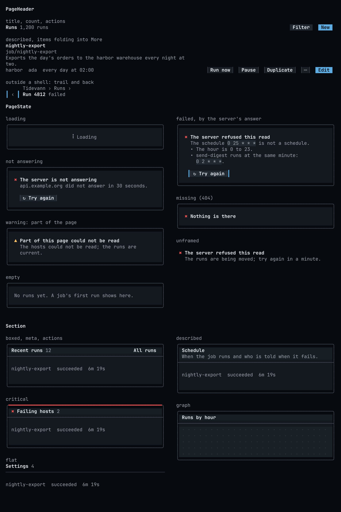
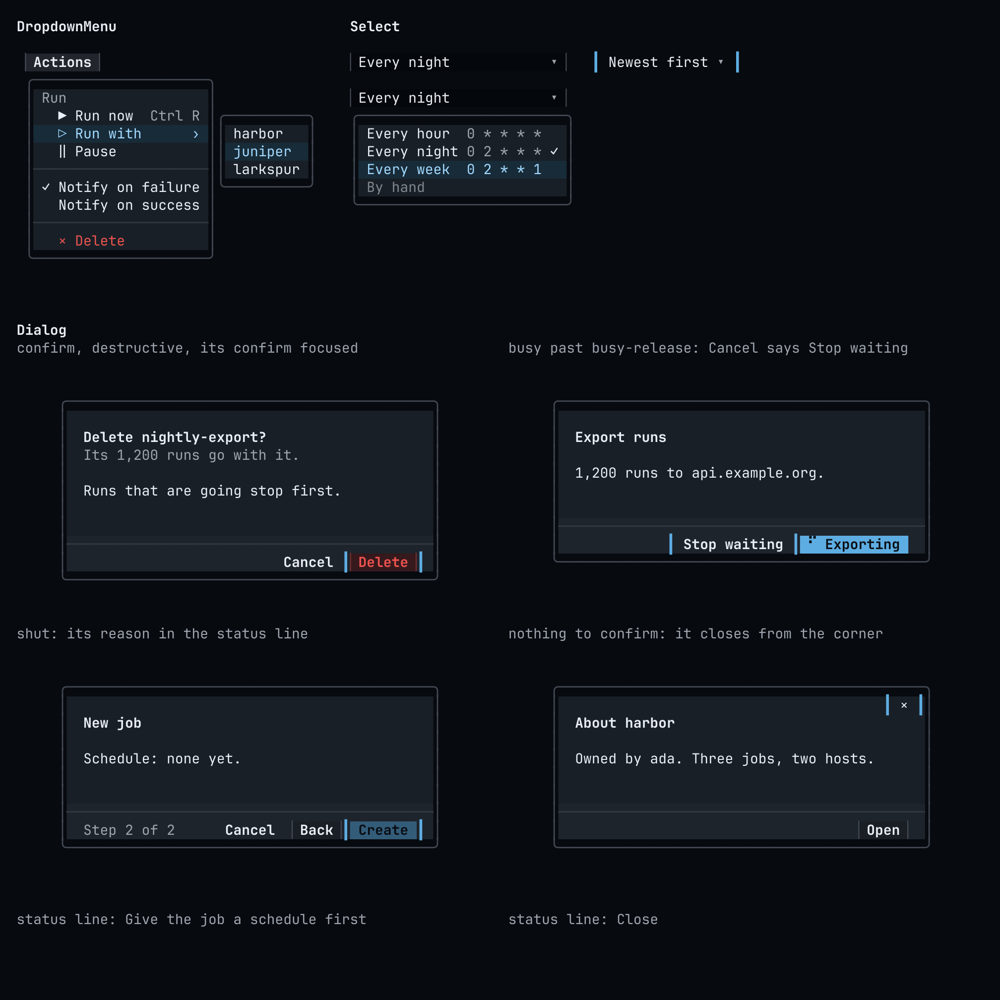

# sokkel-tui

sokkel's design system in a terminal, with ratatui. The same contract as sokkel-ui and
sokkel-egui ([sokkel-design](https://winterop-com.github.io/sokkel-design/): its tokens, paints,
parts and the shell), drawn in cells.



That is the `07_runs` example: `cargo run --example 07_runs`, then Ctrl+K for the palette.

## What is here

- `crates/core` (`sokkel-tui`): sokkel-design's resolved tokens embedded; the look (theme, scheme,
  density, color depth: truecolor, 256 or none); text roles as a cell shows them; px in columns
  and the breakpoints in columns (`md` about 90, `lg` about 120); a buffer as SVG and as text.
- Focus and keys: tab order, layers, the ring on keyboard focus, a shortcuts registry by typed
  character.
- The runtime (`app`): `app::run` drives one screen; `app::run_shell` runs an app in sokkel's frame
  and does what every app does: the rail collapsing and its drawer below md, the command palette
  (Ctrl+K), the settings dialog with the look and the frame, the account menu, the shortcuts
  dialog (`?`), the search (`/`), Tab through the frame and the page, the mouse switched on and
  off, and the look kept between runs. An app gives its parts, its page, its commands and its own
  layers; `app::shot` draws a frame after scripted keys, for tests and specimens.
- The parts, each from its spec in sokkel-design: `Button`, `TextField`, `PageState`, `PageHeader`,
  `Section`, `Table`, the dashboard (`DashboardPanel`, `StatPanel`), the frame (`Rail`, `TopBar`, `StatusLine`), and the overlays `Dialog`,
  `DropdownMenu`, `Select`, `CommandPalette` and `SettingsDialog`.
- `crates/core/examples/`, a progression to run in a terminal (`-- light` for the light scheme;
  Ctrl+Q quits):
  - `01_basic`: a form, focus by Tab, a button with its reason and its busy moment.
  - `02_page`: a page header and a read in its states (keys 1 to 4), sections.
  - `03_table`: the one table, by keys and mouse; narrow the terminal for cards.
  - `04_overlays`: a menu with a submenu, a select, a confirm dialog that holds.
  - `05_palette`: the command palette (Ctrl+K, every theme) and the settings dialog.
  - `06_shell`: the frame on the runtime, around one page.
  - `07_runs`: Tidevann's runs on the runtime: two pages, its commands, a menu and a dialog.
  - `08_gallery`: every part's sheet, browsed (t theme, s scheme, a ASCII, c no color).
  - `09_dashboard`: a dashboard on the runtime: stat tiles, panels in their states, a page that
    scrolls.









## Use

```
make all          # fmt-check, clippy, tests
make specimens    # the spike and the parts sheet: specimens/*.svg, *.png (with rsvg-convert) and *.txt
make tokens       # fetch sokkel-design's resolved tokens at the pinned commit (REF=<commit> moves it)
```

The examples run in a terminal: `cargo run --example 01_basic` up to `09_dashboard`. They draw the
exact colors only when `COLORTERM` is `truecolor` (or `24bit`); otherwise each color is the nearest
of 256, where close grounds (hover, a selected row) can blur together. A terminal known to have
only sixteen (`TERM` of `linux`, `vt100`, `ansi`) gets the contract's sixteen-color reading: each
color by its role (critical red, warning yellow, good green), the terminal's own theme deciding the
shade, hover and selection in reverse video. With `NO_COLOR` set they draw no color at all.
`SOKKEL_COLORS` (`truecolor`, `256`, `16`, `none`) says it outright. Check `echo $COLORTERM` and
`echo $TERM` before judging the look; macOS Terminal.app does not set `COLORTERM`, and inside tmux
it depends on the setup. The specimens are drawn in full color, and some in sixteen.

`docs/plan.md` has the order the parts come in. `docs/proposals/sokkel-design-tui.md` is what the
terminal asks of the contract.
